<div align="center">


# Naquela Mesa

**Cardápio digital e gestão de pedidos para restaurantes, pizzarias e lanchonetes.**

O cliente faz o pedido pelo celular, sem instalar nada.<br>
A loja recebe, prepara e acompanha tudo em um painel que se atualiza sozinho.

<p>


</p>

<p>
<a href="#funcionalidades">Funcionalidades</a> ·
<a href="#como-funciona">Como funciona</a> ·
<a href="#stack">Stack</a> ·
<a href="#rodando-localmente">Rodando localmente</a> ·
<a href="#arquitetura">Arquitetura</a> ·
<a href="#deploy">Deploy</a>
</p>

<br>

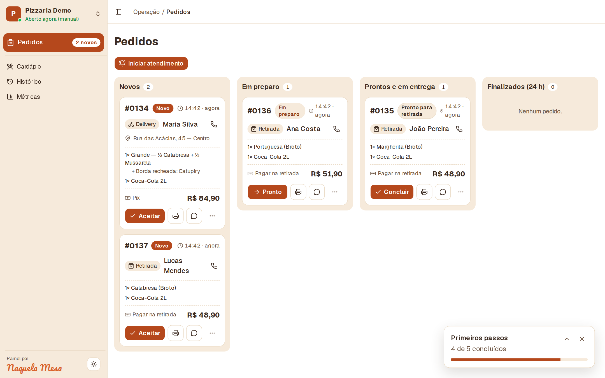

</div>

<br>

## Funcionalidades

### Cardápio público, feito para o celular

Cada loja ganha uma página própria (`/<loja>`) com seu nome, cores e logo. O cliente navega por categorias, escolhe tamanho, sabores meio a meio e adicionais, e fecha o pedido em quatro passos curtos, sem cadastro.

<table>
  <tr>
    <td align="center" width="20%">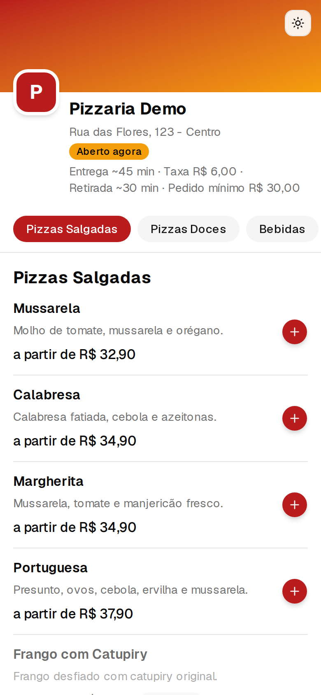</td>
    <td align="center" width="20%">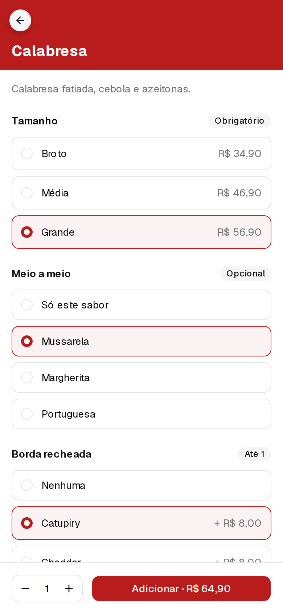</td>
    <td align="center" width="20%">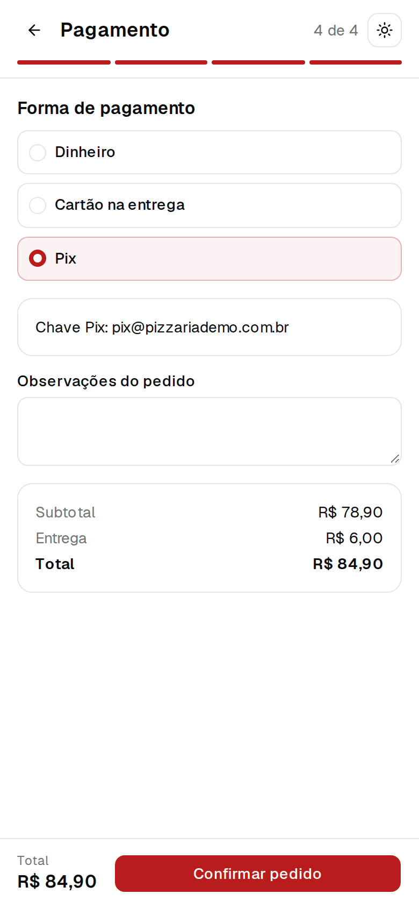</td>
    <td align="center" width="20%"></td>
    <td align="center" width="20%">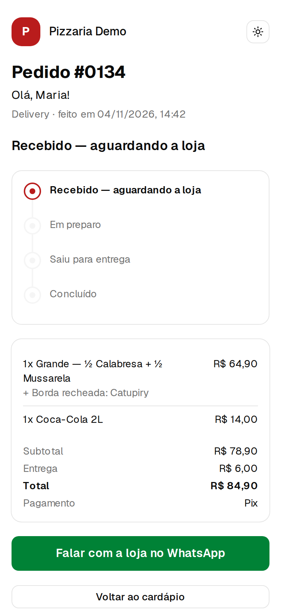</td>
  </tr>
  <tr>
    <td align="center"><sub><b>1.</b> Cardápio</sub></td>
    <td align="center"><sub><b>2.</b> Tamanho, meio a meio e adicionais</sub></td>
    <td align="center"><sub><b>3.</b> Entrega e pagamento</sub></td>
    <td align="center"><sub><b>4.</b> Confirmação e WhatsApp</sub></td>
    <td align="center"><sub><b>5.</b> Acompanhamento</sub></td>
  </tr>
</table>

- Entrega, retirada no balcão ou consumo na mesa
- Dinheiro (com troco), cartão na entrega ou Pix
- Pedido mínimo, taxa de entrega, horários e produtos esgotados respeitados automaticamente
- Resumo do pedido enviado para a loja pelo WhatsApp e link de acompanhamento em tempo real
- Tema claro e escuro

<details>
<summary><b>Ver o cardápio no desktop</b></summary>
<br>
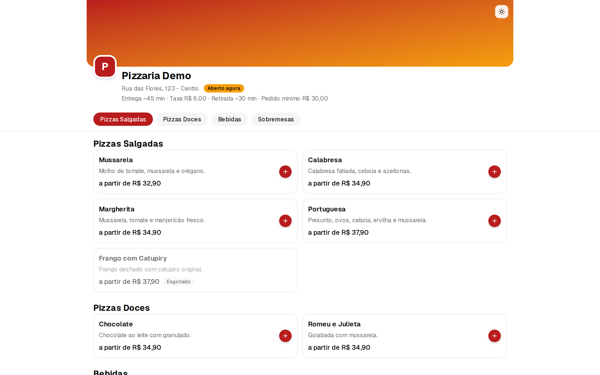
</details>

### Painel da loja (`/painel`)

A operação do dia a dia em uma tela só, pensada para ficar aberta no balcão ou na cozinha.

- **Fila de pedidos** por status (novos, em preparo, prontos, finalizados), com atualização automática, alerta sonoro, aviso no título da aba e tela sempre acesa
- **Comanda** para impressora térmica de 80 mm, com impressão automática ao aceitar
- **Avisos ao cliente** pelo WhatsApp a cada mudança de status
- **Checklist de primeiros passos** até a loja estar pronta para vender

<table>
  <tr>
    <td width="50%">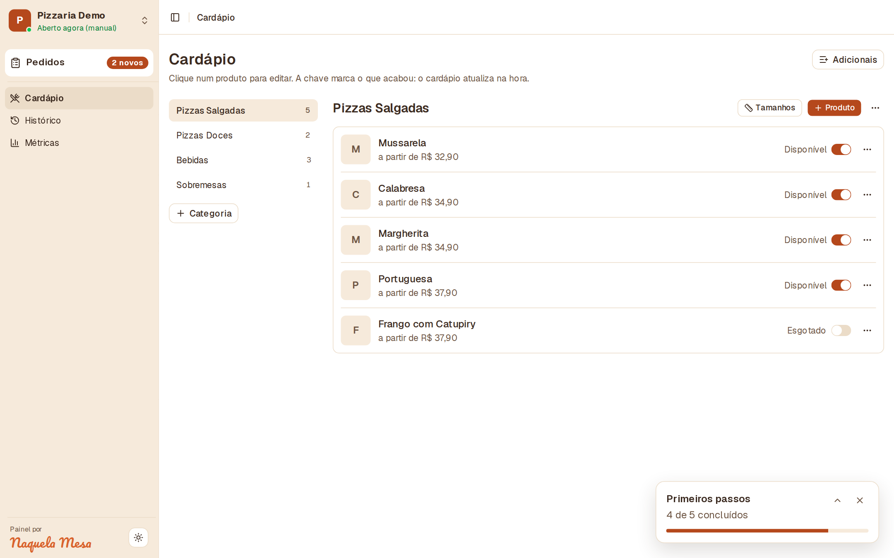</td>
    <td width="50%">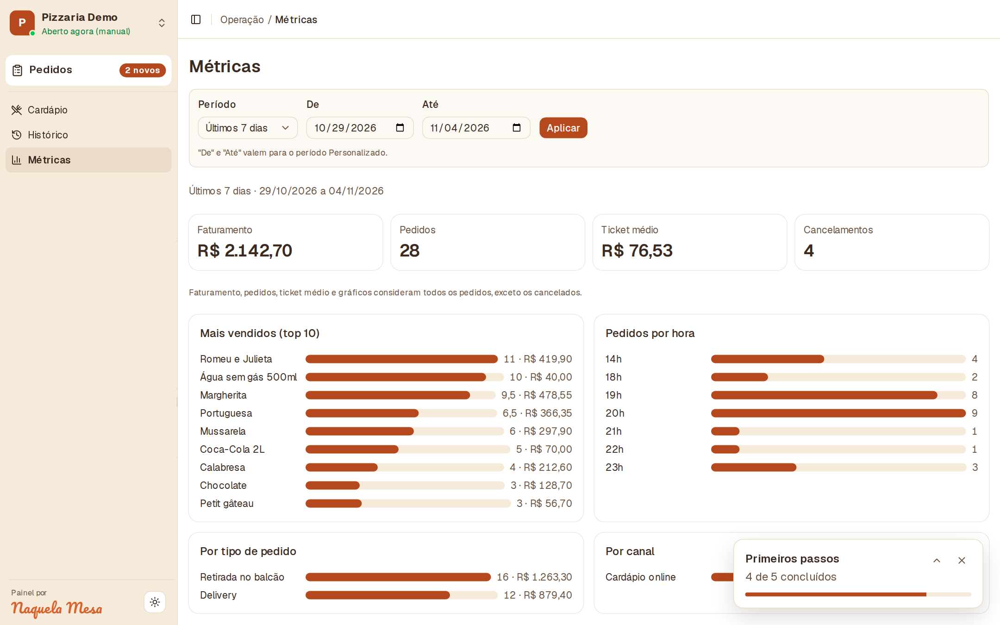</td>
  </tr>
  <tr>
    <td><b>Editor de cardápio.</b> Categorias, produtos, tamanhos, adicionais e disponibilidade. Marcar um item como esgotado reflete na página pública na hora.</td>
    <td><b>Métricas.</b> Faturamento, ticket médio, cancelamentos, produtos mais vendidos e pedidos por hora, tipo e canal, com filtro de período.</td>
  </tr>
  <tr>
    <td>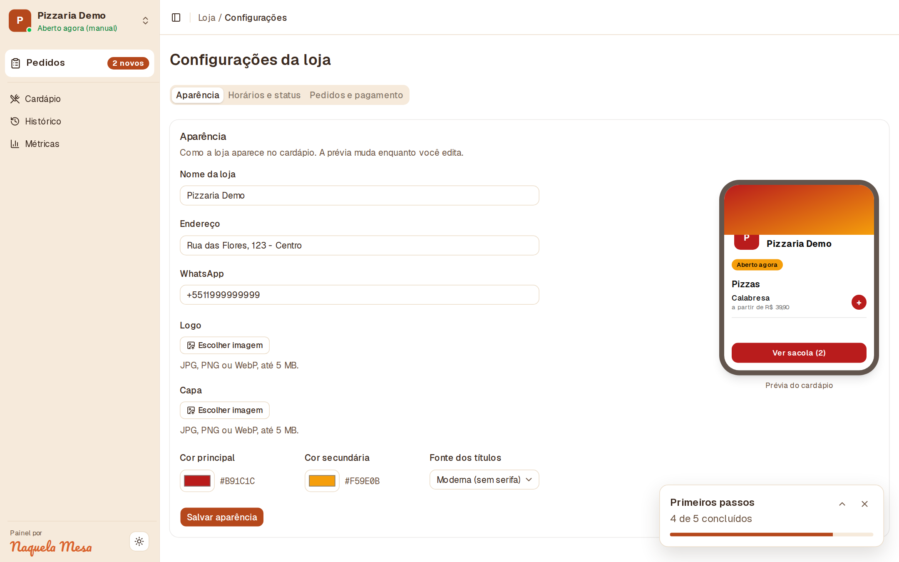</td>
    <td></td>
  </tr>
  <tr>
    <td><b>Configurações da loja.</b> Logo, capa, cores e fonte com prévia ao vivo do cardápio; horários, abertura e fechamento manual, entrega e Pix.</td>
    <td><b>Histórico.</b> Todos os pedidos com filtros e busca.</td>
  </tr>
</table>

### Administração (`/admin`)

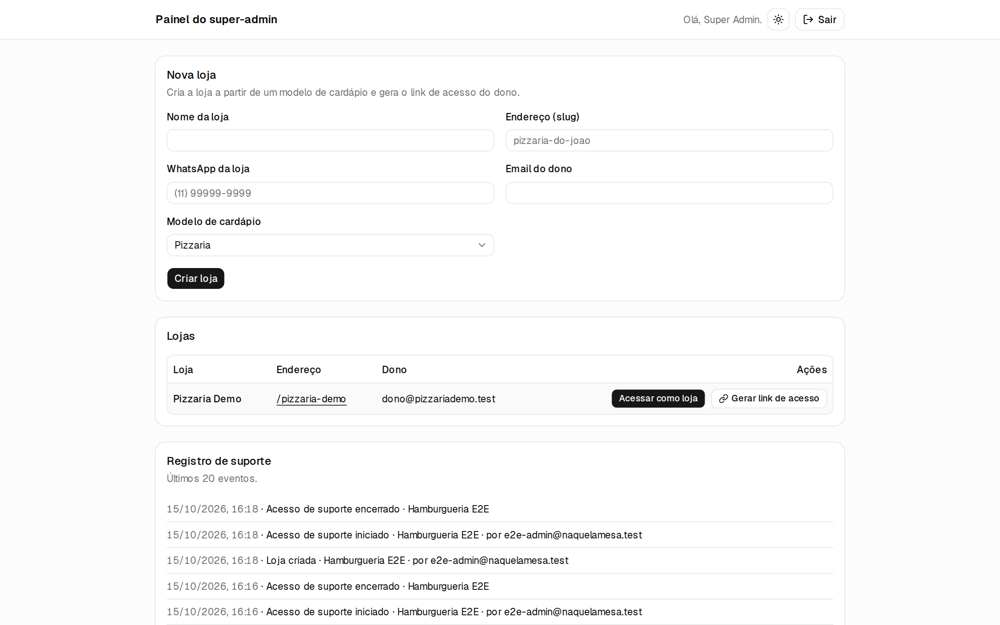

- Criação de lojas a partir de modelos de cardápio prontos
- Link de acesso de uso único para o dono definir a senha (válido por 7 dias)
- Modo suporte para entrar no painel de uma loja, com registro de auditoria

## Como funciona

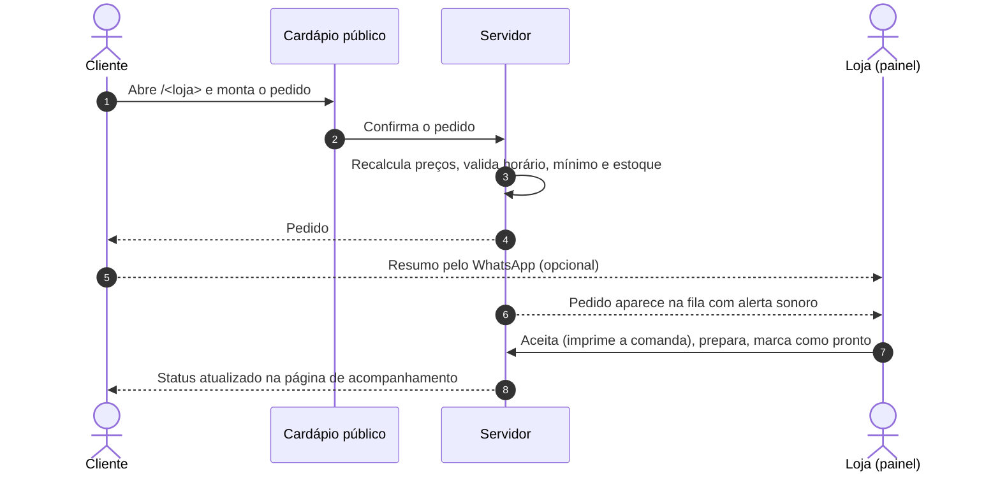

O total exibido no navegador é apenas uma estimativa: **o preço é sempre recalculado no servidor** antes de o pedido ser gravado. A criação de pedidos tem limite de taxa por IP e por telefone.

## Stack

| Camada | Tecnologia |
|---|---|
| Aplicação | Next.js 16 (App Router), React 19, TypeScript, Tailwind CSS 4, shadcn/ui |
| Dados | PostgreSQL + Drizzle ORM, validação com Zod |
| Autenticação | Better Auth |
| Infraestrutura | Vercel, Neon, Upstash Redis (rate limit), Vercel Blob (imagens), Sentry |
| Testes | Vitest (unitários e integração com Testcontainers), Playwright (E2E) |

## Rodando localmente

Requisitos: **Node 24+** e **Docker**.

```bash
make setup    # dependências, .env.local, Postgres, migrações e loja demo
make dev      # http://localhost:3000
```

A loja demo fica em [`/pizzaria-demo`](http://localhost:3000/pizzaria-demo), com cerca de 30 dias de pedidos fictícios para as métricas.

| Acesso | Onde | Credenciais |
|---|---|---|
| Cliente | `/pizzaria-demo` | sem login |
| Dono da loja | `/login` | `dono@pizzariademo.test` / `demo-senha-123` |
| Super-admin | `/login` | crie com `make admin EMAIL=voce@exemplo.com SENHA=uma-senha-forte` |

<details>
<summary><b>Todos os comandos</b></summary>

| Comando | O que faz |
|---|---|
| `make setup` | Primeira instalação completa |
| `make dev` | Sobe o Postgres, migra e roda o servidor (`PORT=3001` para outra porta) |
| `make update` | `git pull`, dependências, migrações e demo |
| `make test` | Lint, tipos, testes unitários e de integração |
| `make e2e` | Build e testes E2E (Playwright), em banco separado |
| `make check` | Tudo o que o CI roda |
| `make db-seed` | Recria a loja demo |
| `make db-studio` | Abre o Drizzle Studio |
| `make admin EMAIL=... SENHA=...` | Cria ou promove um super-admin |
| `make owner SLUG=... EMAIL=... SENHA=...` | Vincula um dono a uma loja |
| `make help` | Lista todos os comandos |

</details>

## Arquitetura

O projeto é um **monólito modular**: uma única aplicação, com um deploy e um banco, organizada por dentro em módulos de domínio com fronteiras rígidas. Cada módulo funciona como um pequeno serviço, com seus dados, suas regras e uma API pública, mas tudo roda no mesmo processo. Fica a simplicidade de operar um monólito sem o acoplamento típico dele, e se um domínio precisar virar um serviço separado, a fronteira já existe.

```
src/
├── app/            rotas, páginas, server actions e APIs (Next.js App Router)
├── modules/        domínio, um diretório por contexto de negócio
│   └── <módulo>/
│       ├── index.ts      API pública para o servidor
│       ├── client.ts     API pública para o navegador (quando existe)
│       ├── schema.ts     tabelas do módulo (Drizzle)
│       └── service.ts    casos de uso
└── shared/         infraestrutura sem regra de negócio: banco, env, dinheiro, validação
```

| Módulo | Responsabilidade |
|---|---|
| `auth` | Login, sessão, papel de super-admin e guardas de acesso |
| `stores` | Lojas, membros, horários, configurações, tema e convites |
| `catalog` | Cardápio, tamanhos, adicionais e disponibilidade |
| `orders` | Checkout, preço, fila, status, histórico e métricas |
| `whatsapp` | Mensagens de pedido e de status |
| `onboarding` | Criação de lojas por modelo e checklist inicial |
| `media` | Validação e armazenamento de imagens |
| `audit` | Registro de ações sensíveis, como o modo suporte |

As fronteiras são verificadas pelo ESLint, então uma violação quebra o CI:

- Um módulo só importa outro pela API pública (`@/modules/<nome>`), nunca por arquivos internos.
- As dependências seguem um único sentido: `app → modules → shared`. Não há ciclos entre módulos.
- Cada módulo declara as próprias tabelas em `schema.ts`; o Drizzle junta todas para gerar as migrações.

## Deploy

O roteiro completo (Vercel, Neon, Upstash, Blob, Sentry, domínio e checklist) está em [`docs/deploy.md`](docs/deploy.md). A branch `main` vai para produção e `dev` gera o ambiente de preview.

Variáveis obrigatórias em produção: `DATABASE_URL`, `BETTER_AUTH_SECRET`, `BETTER_AUTH_URL`, `UPSTASH_REDIS_REST_URL` + `UPSTASH_REDIS_REST_TOKEN` (ou `KV_REST_API_*`) e `BLOB_STORE_ID` (ou `BLOB_READ_WRITE_TOKEN`). Nunca defina `E2E_DISABLE_RATE_LIMIT` em produção.

<br>

<div align="center">
<sub>Naquela Mesa · cardápio digital e gestão de pedidos</sub>
</div>
